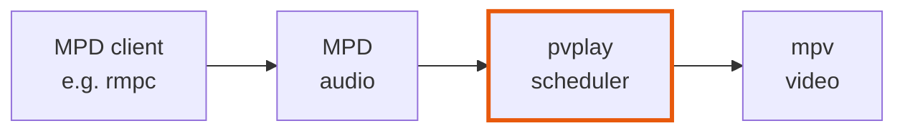

# pvplayer

Plays music videos in sync with [MPD](https://www.musicpd.org), so an album flows from song into video and back without a gap. Written in Rust.



- **Decide without I/O.** The playback controller takes an MPD snapshot and returns an action, so its logic is unit-tested with no MPD or mpv running.
- **Push, not poll.** A second MPD connection blocks on `idle` in its own thread and wakes the main loop on every change.
- **Start before the song does.** The next video is preloaded paused, then started early by its intro length. The loop sleeps half the time left (20 ms–15 s), so it's precise at the handoff and idle otherwise.

## Quick start

Needs macOS or another Unix, Rust 1.85+, MPD with `sticker_file` set, mpv, and ffprobe.

```sh
brew install mpd mpv ffmpeg
cargo build --release
cargo run --release --bin annotate   # link songs to videos, once
cargo run --release                  # then play albums in any MPD client
```

Set `MUSIC_ROOT` (in `src/pv_link/paths.rs` and `src/bin/annotate.rs`) to your MPD music directory. Videos live in `<Artist>/<Artist> [pv]/`.

## Docs

**[ryan-dfw.github.io/pvplayer](https://ryan-dfw.github.io/pvplayer/)**: every item documented, internals included, covering the timing model, sticker schema and limitations. Locally: `cargo docs`.

## Status

`0.0.0-alpha.1`. Built for my own listening, tested on one Mac. Documentation drafted with AI assistance; code written by me.

Licensed under [MIT](LICENSE-MIT) or [Apache-2.0](LICENSE-APACHE), at your option.
